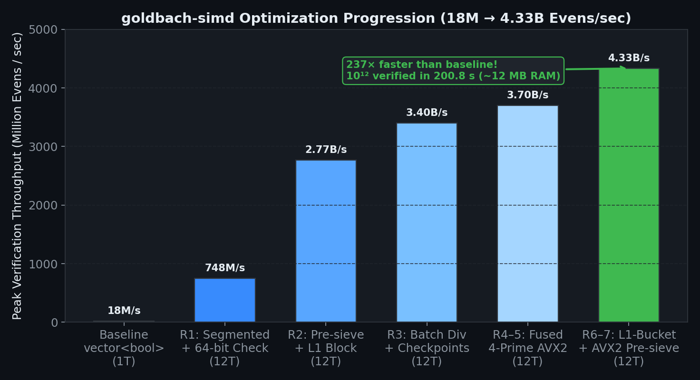

# goldbach-simd

[](https://github.com/JosephJonathanFernandes/goldbach-simd/actions/workflows/ci.yml)

High-throughput C++ Goldbach conjecture verifier using a cache-blocked segmented bucket sieve, AVX2 bit-parallel checks, multithreading, and checkpointing.

## Highlights

- **Cache-blocked segmented sieve** with $O(\sqrt{N})$ memory (~12 MB total across 12 threads at $10^{12}$).
- **AVX2 byte-aligned L1 pre-sieve** combining 5 periodic bit patterns (26 KB total, fully L1-resident) to eliminate all odd primes 3..47 at 256 bits per iteration with zero bit-shifts.
- **8× constant-mask unrolled sieve wheel** eliminating variable bit-shifts in the inner L1 loop (`b += p` with fixed byte masks).
- **L1-threshold bucket sieve** ($p \ge 2^{18}$) + **contiguous chunk batching** to amortize 64-bit divisions.
- **4-prime fused AVX2 SIMD kernel** checking 256 even numbers per iteration in YMM registers (with SSE2 and scalar fallbacks).
- **Deterministic 64-bit Miller-Rabin fallback** so no even number can ever be falsely verified.
- **Built-in $\pi(N)$ self-check** against known prime counts up to $10^{12}$ and **checkpoint/resume** support.

## Benchmarks (12 threads)

| $N$ | Baseline (`baseline.cpp`) | `goldbach.cpp` (12T) | Throughput | Largest min $p$ ($n = p + q$) | $\pi(N)$ |
|---:|---:|---:|---:|---|---:|
| $10^8$ | 2.315 s | **0.093 s** | 539 M evens/s | `1093` ($60{,}119{,}912$) | `5,761,455` |
| $10^9$ | 27.261 s | **~0.14 s** (0.757 s 1T) | — | `1789` ($721{,}013{,}438$) | `50,847,534` |
| $10^{10}$ | *(1.25 GB RAM)* | **1.154 s** | **4.33 B evens/s** | `1877` ($7{,}473{,}202{,}036$) | `455,052,511` |
| $10^{11}$ | *(12.5 GB RAM)* | **13.827 s** | **3.62 B evens/s** | `2803` ($35{,}884{,}080{,}836$) | `4,118,054,813` |
| $10^{12}$ | *(125 GB RAM)* | **200.813 s** | **2.49 B evens/s** | `3457` ($599{,}533{,}546{,}358$) | `37,607,912,018` |



## Research Frontiers (`research_suite.cpp`, `carry_exact.cpp`)

Beyond standard Goldbach verification, [`research_suite.cpp`](research_suite.cpp) and [`carry_exact.cpp`](carry_exact.cpp) apply the same AVX2 sieve engine to four computational number theory & CS frontiers — full results in **[`RESEARCH.md`](RESEARCH.md)** and the arXiv-ready LaTeX preprint **[`paper/carry_optimal_goldbach.tex`](paper/carry_optimal_goldbach.tex)**:

1. **Lemoine's Conjecture ($n = p + 2q$) to $10^{12}$:** verified all 500 billion odd numbers up to $10^{12}+1$ in **277.8 s** (100× past the standard $10^{10}$ literature milestone), maximal minimal $q = 3079$ at $n = 853{,}036{,}242{,}229$.
2. **Twin-Prime Goldbach to $10^{10}$:** verified all 5 billion evens in **37.7 s** — exactly **34 exceptions** total, largest exception `4208`, maximal minimal twin-prime witness `299,359` at $n = 8{,}115{,}525{,}848$.
3. **Goldbach Binary Carry Excess $\Delta_c^*(n)$ ($10^9$ + Unconditional Theorems):** proved exact submask characterization ($p = 1|s, q = 1|((n-2)\oplus s)$), **proved unconditionally** that *every* binary weight $w \ge 1$ has infinitely many exceptions via a $(2r+1)$ multiplicative-order covering construction bracketing $W_{\max}(N) \in [(\frac{1}{2}-o(1))\ln\ln N,\; (\frac{2}{\ln 2}+o(1))\ln\ln N]$, and ran an exact 500M-even census finding a unique $w = 12$ exception (`743,309,774`) and `0 / 378.76M` for $w \ge 13$.
4. **Information Theory of $p_{\min}(n)$ ($10^{10}$):** measured $H(p_{\min}) = 4.8616\text{ bits}$, super-mod-6 lag-1 mutual information $I = 1.5872\text{ bits} > \log_2 3$ (twin-prime witness propagation), and a Chebyshev witness inversion where `p = 31` beats `p = 29`.

## Build & Run

```bash
# Using Make
make
make test

# Or directly (Linux / macOS / MSYS2)
g++ -O3 -march=native -std=c++17 -pthread goldbach.cpp -o goldbach

# Windows (MinGW)
g++ -O3 -march=native -std=c++14 goldbach.cpp -o goldbach.exe
```

Usage:

```bash
./goldbach [N] [threads] [checkpoint_file]
./goldbach --range LO HI [threads] [checkpoint_file]

# Examples
./goldbach 1e10
./goldbach 1e12 12 goldbach_1e12.ckpt
./goldbach --range 1000000000000000 1000001000000000 12   # 1B-wide shard at 10^15 in 1.14 s!
```
