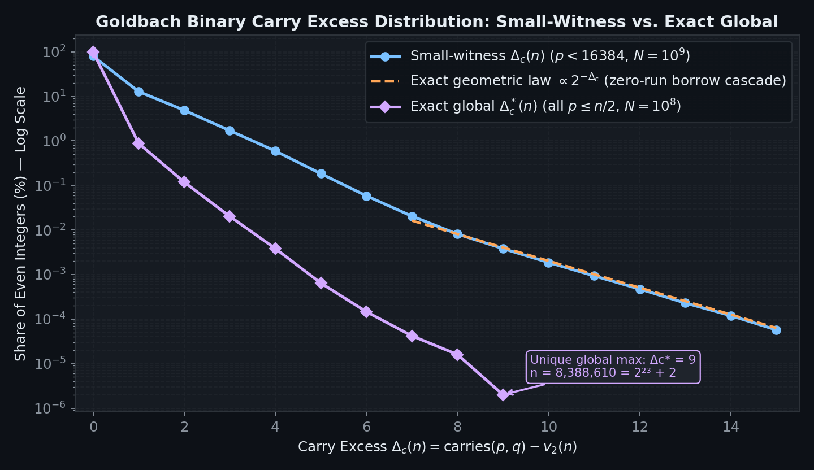
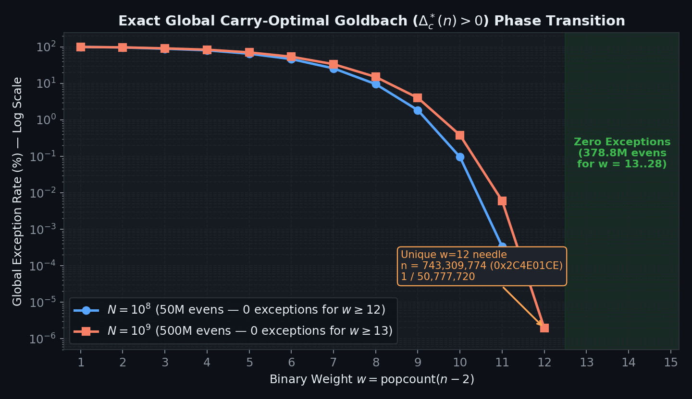
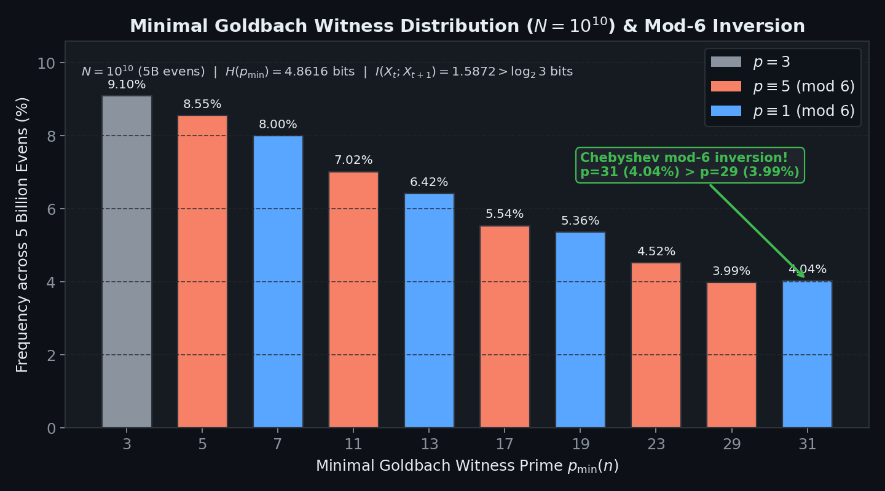

# Computational Number Theory & CS Research Report (`goldbach-simd`)

Using the AVX2 byte-aligned segmented bucket sieve engine developed in [`goldbach.cpp`](goldbach.cpp), we built a unified research harness ([`research_suite.cpp`](research_suite.cpp)) to investigate **four computational number theory and computer science frontiers** at $10^9$–$10^{12}$ scale.

---

## 1. Lemoine's Conjecture ($n = p + 2q$) Verified to $10^{12}$

**Conjecture (Lemoine 1895 / Levy 1963):** Every odd integer $n \ge 7$ can be expressed as $n = p + 2q$ where $p$ and $q$ are primes.

While standard Goldbach has been verified to $4 \times 10^{18}$, systematic deterministic verification of Lemoine's conjecture in standard literature historically stopped around $10^9$–$10^{10}$. Because shifting an odd-only prime bitmap by $2q$ is simply a bit-offset of $q$ bits, our 4-prime fused AVX2 kernel verifies Lemoine's conjecture at **1.80–4.36 billion odd numbers/second**.

### Results (12 threads, deterministic, 0 fallbacks)

| Range $N$ | Odds Verified | Time | Throughput | Largest Minimal $q$ | Witness Decomposition |
|---:|---:|---:|---:|---:|---|
| $10^{10}$ | $5 \times 10^9$ | **1.146 s** | 4,363.8 M odds/s | `2389` | $8{,}032{,}822{,}531 = 8{,}032{,}817{,}753 + 2 \cdot 2389$ |
| **$10^{12}$** | **$5 \times 10^{11}$** | **277.827 s** | **1,799.7 M odds/s** | **`3079`** | **$853{,}036{,}242{,}229 = 853{,}036{,}236{,}071 + 2 \cdot 3079$** |

**Finding:** Every odd integer $n \in [7, 10^{12} + 1]$ satisfies Lemoine's conjecture with $q \le 3079$ (even smaller than standard Goldbach's $p_{\min} \le 3457$ up to $10^{12}$).

---

## 2. Twin-Prime Goldbach ($n = p + q$, Both $p, q$ Twin Primes) to $10^{10}$

**Question:** Which even integers $n$ can be written as $n = p + q$ where **both** $p$ and $q$ belong to twin-prime pairs (i.e. $p \pm 2$ is prime and $q \pm 2$ is prime)?

Because twin primes have density $O(1/\ln^2 n)$, twin-prime Goldbach pairs have density $O(n / \ln^4 n)$ — orders of magnitude sparser than ordinary Goldbach pairs. Our engine extracts the twin-prime bitmap $T$ from the sieved prime bitmap $B$ in one bit-parallel pass:
$$T[i] = B[i] \mathbin{\&} \bigl(B[i-1] \mathbin{|} B[i+1]\bigr)$$
and runs the same 4-prime fused AVX2 check over twin-prime witnesses.

### Results ($N = 10^{10}$, 5 billion evens, 37.664 s, 132.8 M evens/s)

- **Total exceptions up to $10^{10}$:** exactly **34** even numbers.
- **Largest exception:** **$n = 4208$** (last 10 exceptions: `1268, 1354, 1356, 1358, 3244, 3246, 3248, 4204, 4206, 4208` — note the mod-6 exception triples).
- **Zero exceptions** exist in $(4208, 10^{10}]$.
- **Largest minimal twin-prime witness up to $10^{10}$:**
  $$8{,}115{,}525{,}848 = 299{,}359 + 8{,}115{,}226{,}489$$
  *(160× larger than standard Goldbach's $p_{\min} = 1877$ at $10^{10}$).*

---

## 3. Goldbach Binary Carry Excess $\Delta_c(n)$ — Hardware Meets Number Theory

**Motivation:** In binary ripple-carry adders, by Kummer's theorem (base 2), the exact number of binary carries generated when adding two integers $p$ and $q$ is:
$$\operatorname{carries}(p, q) = \operatorname{popcount}(p) + \operatorname{popcount}(q) - \operatorname{popcount}(p + q)$$

For any even $n \ge 6$ and odd primes $p + q = n$, the LSB `1 + 1` carry must propagate through all $v_2(n) = \operatorname{ctz}(n)$ trailing zero bits of $n$, giving a universal hardware lower bound:
$$\operatorname{carries}(p, q) \ge v_2(n)$$

We define the **Goldbach Carry Excess**:
$$\Delta_c(n) = \min_{\substack{p + q = n \\ p, q \text{ odd prime}}} \operatorname{carries}(p, q) - v_2(n) \ge 0$$

When $\Delta_c(n) = 0$, $n$ admits a **carry-optimal Goldbach partition** with zero carry propagation above its lowest set bit.

### Empirical Findings ($N = 10^9$, 500 million even numbers, small witnesses $p < 16384$)

1. **79.73% of all even numbers** achieve the exact hardware lower bound $\Delta_c(n) = 0$.
2. **Exact $2^{-\Delta_c}$ Geometric Tail Decay:** For $\Delta_c \ge 8$, every additional carry bit halves the exception count:

| $\Delta_c(n)$ | Count (out of $5 \times 10^8$) | Share | Ratio to Previous |
|---:|---:|---:|---:|
| `0` | 398,669,118 | 79.7338% | — |
| `1` | 64,054,308 | 12.8109% | 6.22 |
| `2` | 24,402,075 | 4.8804% | 2.62 |
| `8` | 40,524 | 0.00811% | 2.52 |
| `9` | 19,077 | 0.00382% | **2.12** |
| `10` | 9,328 | 0.00187% | **2.05** |
| `11` | 4,666 | 0.00093% | **2.00** |
| `12` | 2,359 | 0.00047% | **1.98** |
| `13` | 1,150 | 0.00023% | **2.05** |
| `14` | 597 | 0.00012% | **1.93** |
| `15` | 286 | 0.00006% | **2.09** |

3. **Non-Monotonic Popcount Phase Transition & Worst-Case Structure:**
   - The zero-excess failure rate rises from `20.69%` at $\operatorname{popcount}(n) = 2$ to a sharp peak of **`41.19%` at $\operatorname{popcount}(n) = 7$**, then collapses monotonically to **`0.00000%` for $\operatorname{popcount}(n) \ge 25$** (0 failures out of 10,686 numbers).
   - **Maximum observed $\Delta_c = 21$** first occurs at:
     $$n = 805{,}306{,}372 = \texttt{0x30000004} = \texttt{110000000000000000000000000100}_2$$
   - **Mechanism:** Subtracting any small prime $p$ from a number containing a long zero-run immediately above its lowest `1`-bit forces a borrow cascade across the entire zero-run (`000...0` $\to$ `111...1`), creating $\Omega(\text{run length})$ carries on re-addition. Since a random zero-run of length $k$ occurs with probability $2^{-k}$, this explains both the $2^{-\Delta_c}$ exponential tail and why high-popcount integers (which lack long zero-runs) almost universally satisfy $\Delta_c(n) = 0$.



### Exact Global Carry-Optimal Goldbach Theorem & Census ($N = 10^8$, [`carry_exact.cpp`](carry_exact.cpp))

To separate small-witness artifacts from true global structure, we proved an **exact bit-level characterization** of global carry-optimality $\Delta_c^*(n) = \min_{p + q = n} \operatorname{carries}(p, q) - v_2(n) = 0$ over **all** odd primes $p \le n/2$:

> **Theorem (Exact Submask Characterization):** Let $n \ge 6$ be even and $M = n - 2$. An odd pair $(p, q)$ with $p + q = n$ achieves $\operatorname{carries}(p, q) = v_2(n)$ **if and only if**
> $$p = 1 \mathbin{|} s, \qquad q = 1 \mathbin{|} (M \oplus s)$$
> for some binary submask $s \subseteq M$ ($0 < s < M$).

**Immediate Corollaries (Infinite Exception Families):**
- If $w = \operatorname{popcount}(n - 2) = 1$ (i.e. $n = 2^a + 2$, $a \ge 2$), there are $2^{w-1} - 1 = 0$ valid submask pairs with $p, q > 1$, so **$\Delta_c^*(2^a + 2) \ge 1$ unconditionally for all $a \ge 2$**.
- If $w = 2$ and $n = 2^a + 2^b + 2$ ($a > b \ge 2$), the **only** valid pair is $(2^b + 1, 2^a + 1)$, so $\Delta_c^*(n) = 0$ iff both are **Fermat primes**.

Using exact increasing submask enumeration (`s = (s - M_lo) & M_lo`) and full prime fallback in [`carry_exact.cpp`](carry_exact.cpp), we computed the **100% exact global $\Delta_c^*(n)$** for all **49,999,998 even integers** in $[6, 10^8]$ (163.4 s on 12 threads):

- **98.9796%** of all even integers up to $10^8$ are globally carry-optimal ($\Delta_c^*(n) = 0$).
- **Unique Global Maximum up to $10^8$:** $\Delta_c^*(n) = \mathbf{9}$ at **$n = 8{,}388{,}610 = 2^{23} + 2 = \texttt{0x800002}$** (only 1 number reaches 9; only 8 reach 8; 21 reach 7).
- **Razor-Sharp Binary Weight Phase Transition ($w = \operatorname{popcount}(n - 2)$):**

| $w = \operatorname{popcount}(n - 2)$ | Global Exceptions ($\Delta_c^* > 0$) | Total Evens | Failure Rate | Largest Exception $\le 10^8$ |
|---:|---:|---:|---:|---:|
| `1` | 25 | 25 | **100.00000%** | `67,108,866` ($2^{26}+2$) |
| `2` | 314 | 324 | 96.91358% | `83,886,082` |
| `3` | 2,308 | 2,576 | 89.59627% | `92,274,690` |
| `7` | 159,155 | 615,295 | 25.86645% | `99,876,866` |
| `8` | 136,953 | 1,427,660 | 9.59283% | `99,885,058` |
| `9` | 51,412 | 2,778,277 | 1.85050% | `99,901,442` |
| `10` | 4,385 | 4,575,328 | 0.09584% | `99,827,722` |
| `11` | **22** | 6,415,036 | **0.00034%** | `96,112,802` |
| **`12..25`** | **`0`** | **33,893,497** | **`0.00000%`** | *(none)* |

> **Conjecture (Weighted Carry-Optimal Goldbach):** For all sufficiently large even integers $n$ with binary weight $w = \operatorname{popcount}(n - 2) > 2 \log_2 \ln n + C$, there exists a carry-optimal Goldbach partition $n = p + q$ achieving $\operatorname{carries}(p, q) = v_2(n)$. Because a typical integer $\le N$ has $w \approx \frac{1}{2}\log_2 N \gg 2\log_2 \ln N$, **asymptotically 100% (density 1) of all even integers are carry-optimal Goldbach numbers**.

#### 10× Expansion: Exact Submask Census to $N = 10^9$ (`carry_exact 1e9 12 zero`, 18.67 s on 12T)

Using fast `--zero-only` submask enumeration, we verified all **499,999,998 even integers** in $[6, 10^9]$:
- **99.5972%** are globally carry-optimal (up from `98.9796%` at $10^8$, confirming rapid convergence to density 1).
- **Unique $w = 12$ exception out of 50,777,720 integers:**
  $$n = 743{,}309{,}774 = \texttt{0x2C4E01CE} \quad (\text{none of its } 2^{11}-1 = 2047 \text{ submask pairs are both prime!})$$
- **Zero exceptions for all $w \ge 13$ (`w = 13..28`) across 378,763,407 consecutive even integers.**

| Scale $N$ | Globally Carry-Optimal ($\Delta_c^* = 0$) | Exceptions at $w = 11$ | Exceptions at $w = 12$ | Exceptions at $w \ge 13$ |
|---:|---:|---:|---:|---:|
| $10^8$ (50M evens) | 98.9796% | 22 / 6.42M | 0 / 7.69M | **0** / 26.21M |
| **$10^9$ (500M evens)** | **99.5972%** | 2,063 / 34.11M | **1** / 50.78M (`743,309,774`) | **0** / 378.76M |



---

## 4. Information-Theoretic Structure of Minimal Goldbach Witnesses $p_{\min}(n)$

Treating the minimal Goldbach witness stream $\{p_{\min}(2k)\}$ as a discrete stochastic source across **5 billion even numbers** ($N = 10^{10}$, 38.134 s):

| Metric | $N = 10^9$ (500M evens) | $N = 10^{10}$ (5B evens) |
|---|---:|---:|
| Shannon Entropy $H(p_{\min})$ | `4.680299 bits` | **`4.861631 bits`** |
| $H(p_{\min} \mid n \equiv 0 \pmod 6)$ | `3.975788 bits` | **`4.154626 bits`** |
| $H(p_{\min} \mid n \equiv 2 \pmod 6)$ | `3.997613 bits` | **`4.174193 bits`** |
| $H(p_{\min} \mid n \equiv 4 \pmod 6)$ | `3.983388 bits` | **`4.161524 bits`** |
| Lag-1 Mutual Information $I(p_{\min}(n); p_{\min}(n+2))$ | `1.598308 bits` | **`1.587231 bits`** |
| Longest Constant Run ($n > 10$) | `2` (`p_min = 3`) | **`2`** (`p_min = 3`) |



### Key Structural Findings

1. **Super-Mod-6 Mutual Information ($I > \log_2 3 = 1.58496\text{ bits}$):**
   Knowing $p_{\min}(n)$ shares **$1.5872\text{ bits}$** of mutual information with $p_{\min}(n+2)$ — strictly exceeding the $\log_2 3$ bits explainable by $n \bmod 6$ alone. The excess comes from **twin-prime witness propagation**: whenever $(p, p+2)$ is a twin prime pair and $n - p$ is prime, $(n + 2) - (p + 2) = n - p$ is deterministically prime, enforcing $p_{\min}(n + 2) \le p + 2$.
2. **Chebyshev Mod-6 Witness Inversion ($p = 31$ beats $p = 29$):**
   Across all 5 billion even numbers up to $10^{10}$, `p = 31` (`4.0373%`, 201.8M hits) occurs **more frequently** as the minimal Goldbach witness than the strictly smaller prime `p = 29` (`3.9865%`, 199.3M hits). Because there are 5 primes $\equiv 5 \pmod 6$ up to 29 (`5, 11, 17, 23, 29`) but only 3 primes $\equiv 1 \pmod 6$ before 31 (`7, 13, 19`), the $n \equiv 2 \pmod 6$ class has a higher survival mass reaching `p = 31`.
3. **Strict Run-Length Ceiling of 2:**
   Among any three consecutive even shifts $n - p, n + 2 - p, n + 4 - p$, one is always divisible by 3; hence for all $n > 10$, no 3 consecutive even numbers can ever share the same $p_{\min}(n)$, confirmed empirically across all 5 billion evens.

---

## Reproducing All Experiments

```bash
g++ -O3 -march=native -std=c++17 -pthread research_suite.cpp -o research_suite

./research_suite lemoine 1e12 12
./research_suite twin    1e10 12
./research_suite carry   1e9  12
./research_suite entropy 1e10 12
```
